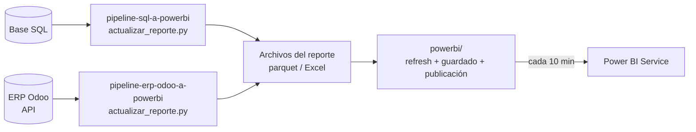

# Automatización de reportes: del sistema a Power BI

Reemplaza el trabajo manual de exportar datos de un sistema y pegarlos en
Excel. Un script por fuente extrae los datos, los transforma, los valida y
deja el archivo que lee Power BI; y un módulo aparte refresca el informe y lo
publica solo, cada 10 minutos.

> Es un patrón que uso en producción, reescrito de forma genérica y con datos
> de ejemplo inventados. Cada parte se prueba en un minuto, sin conectarse a
> nada.



| Carpeta | Qué hace | Documentación |
|---|---|---|
| [`pipeline-sql-a-powerbi/`](pipeline-sql-a-powerbi/) | Actualiza el reporte desde una **base SQL**: extracción incremental por bloques, con reintentos y validación antes de escribir | [README](pipeline-sql-a-powerbi/) · [Código](pipeline-sql-a-powerbi/docs/recorrido-del-codigo.md) |
| [`pipeline-erp-odoo-a-powerbi/`](pipeline-erp-odoo-a-powerbi/) | Actualiza el reporte desde un **ERP (Odoo)** por su API, cada minuto, con caché de días cerrados | [README](pipeline-erp-odoo-a-powerbi/) · [Código](pipeline-erp-odoo-a-powerbi/docs/recorrido-del-codigo.md) |
| [`powerbi/`](powerbi/) | Refresca el `.pbix` en Power BI Desktop, lo guarda y lo **publica cada 10 minutos con Pro y sin gateway** | [README](powerbi/) |

## Probarlo

Python 3.10 o superior.

```bash
cd pipeline-sql-a-powerbi
pip install -r requirements.txt
python generar_datos_demo.py && python actualizar_reporte.py
python -m unittest discover -s tests

cd ../pipeline-erp-odoo-a-powerbi        # sin .env usa un Odoo simulado
pip install -r requirements.txt
python actualizar_reporte.py
python -m unittest discover -s tests
```

## Lo que tienen en común

- **Incremental y sin duplicar.** Cada corrida trae sólo lo necesario y
  reemplaza entera una ventana de días: un registro anulado en el sistema
  también desaparece del reporte, y correrlo dos veces da el mismo resultado.
- **Robusto ante fallas de red.** Reintentos con espera, consultas en bloques y
  paginado estable.
- **Nunca deja un archivo roto.** Escritura atómica, validación antes de
  escribir, y si Power BI tiene el archivo abierto, espera o lo deja para la
  próxima corrida.
- **Corre solo y deja rastro.** Programador de tareas de Windows, log por día
  y una línea de estado.
- **Credenciales fuera del código**, en un `.env` que no se sube.
- **Probado.** 19 tests y datos de demostración para cada fuente.

## Tecnologías

Python (pandas, SQLAlchemy, pyarrow, openpyxl, `xmlrpc`) · SQL · Odoo ·
Parquet · PowerShell · Programador de tareas de Windows · Power BI (XMLA, TOM,
Service) · `unittest`

---

**Carlos Bordón** — Analista de BI
