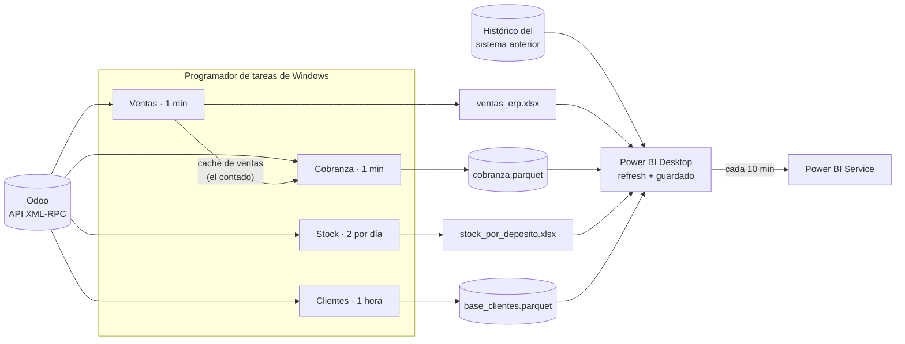

# Pipeline ERP (Odoo) → Power BI, al minuto

Automatización que lee ventas, cobranza, stock y clientes de **Odoo** por su
API, los traduce al esquema que ya usaban los informes y mantiene publicado un
informe de **Power BI** actualizado cada 10 minutos durante toda la jornada,
con licencia Pro y sin gateway.

> Es la versión genérica de un pipeline que corre en producción en una empresa
> comercial que migró su ERP a Odoo. El código se reescribió sin ningún dato,
> regla ni nombre de esa empresa, y trae un **Odoo simulado** (una ferretería
> mayorista inventada) para probarlo sin una instancia de Odoo.

**→ [Recorrido por el código, archivo por archivo](docs/recorrido-del-codigo.md)** ·
**→ [Publicación en Power BI sin gateway](powerbi/README.md)**

---

## El problema

- La empresa **cambió de ERP**. Los informes de Power BI ya existían, leían
  tablas con un esquema fijo, y el negocio no podía quedarse sin ellos ni un
  día.
- La venta del día se veía con horas de atraso: alguien exportaba un reporte y
  lo pegaba en un Excel a mano.
- Con Power BI Pro, el servicio permite **8 actualizaciones por día**, y para
  leer archivos de la PC pide un **gateway**.

## Qué hace

| Tarea | Script | Cada cuánto | Resultado |
|---|---|---|---|
| Ventas | [`actualizar_ventas.py`](actualizar_ventas.py) | 1 min | Todas las ventas de Odoo, incluido el día en curso, en el Excel que Power BI apendea al histórico |
| Cobranza | [`actualizar_cobranza.py`](actualizar_cobranza.py) | 1 min | Contado (sale de las ventas) + crédito (sale de los pagos), por vendedor y sucursal |
| Stock | [`actualizar_stock.py`](actualizar_stock.py) | 07:30 y 13:00 | Existencias por depósito con los nombres que usan los filtros del informe |
| Clientes | [`actualizar_clientes.py`](actualizar_clientes.py) | 1 hora | Agrega a la base de clientes los RUC nuevos, con canal "A DEFINIR" |
| Publicación | [`powerbi/actualizar_y_publicar.ps1`](powerbi/actualizar_y_publicar.ps1) | 10 min | Refresca el `.pbix` en Desktop, lo guarda y lo publica al servicio |



## Probarlo en 1 minuto

Requiere Python 3.10 o superior. Sin `.env`, todo corre contra el Odoo simulado.

```bash
pip install -r requirements.txt

python actualizar_ventas.py      # 1ra vez: baja todo; después, sólo 10 días + hoy
python actualizar_cobranza.py
python actualizar_stock.py
python actualizar_clientes.py

python -m unittest discover -s tests -v   # 14 tests
```

Las ventas muestran algo así, con los avisos de lo que no está mapeado:

```
VENTAS ODOO 17/08/2026 -> 01/10/2026 (incluye hoy)
   [DEMO] sin ODOO_URL en .env: se usa un Odoo simulado con datos inventados
   Odoo: 79 comprobantes publicados en [2026-09-21, 2026-10-01)
   Líneas sin asiento de costo en Odoo: 24 (costo tomado de la ficha)
   [AVISO] usuario 10 'Fabián Rojas' sin código de vendedor: sale como 9010 (agregarlo a VENDEDOR_POR_USUARIO)
   [AVISO] diarios sin sucursal (salen como 99): ['Facturas Feria']
   Odoo: 9 comprobantes publicados en [2026-10-01, 2026-10-02)
            comprobantes  lineas     neto_gs    costo_gs
dia
2026-09-29             9      21  98,955,986  67,400,788
2026-09-30             9      26 161,662,193 102,281,805
2026-10-01             9      23  85,110,760  54,209,347
   Total: 363 comprobantes, 967 líneas, 4,628,730,814 Gs
[OK] ventas_erp.xlsx escrito en 0.3 s
```

Contra un Odoo real: copiar `.env.example` a `.env`, completar URL, base,
usuario y API key, y ajustar las tablas de traducción de [`config.py`](config.py).
Para dejarlo programado: `powershell -ExecutionPolicy Bypass -File programar_tareas.ps1`.

## Decisiones de diseño

Cada una salió de un problema real en producción.

- **Traducir al esquema viejo, no rehacer los informes.** Una capa de
  traducción ([`lib/traduccion.py`](lib/traduccion.py)) convierte las facturas
  de Odoo al mismo esquema de columnas que tenía el sistema anterior. Los
  informes siguieron funcionando el día del cambio sin tocar una medida.
- **Reemplazar el proceso manual escribiendo el mismo archivo.** El Excel que
  alguien pegaba a mano ahora lo escribe el script, con las mismas columnas y
  los mismos tipos (Power Query castea cada columna: un entero escrito como
  texto rompe el refresh). El modelo de Power BI no se enteró.
- **Caché de días cerrados + ventana de re-extracción.** Bajar todo cada minuto
  sería lento. Los días cerrados se guardan y en cada corrida se re-extraen
  sólo los últimos 10 y el de hoy. La ventana existe porque en Odoo una factura
  cancelada **desaparece** (no deja una fila que la anule) y se puede cancelar
  días después.
- **La nota de crédito hereda la condición de la factura.** El asistente de
  Odoo no copia el término de pago al revertir. Sin término, la NC de una venta
  a crédito salía como contado y restaba en la caja plata que nunca había
  entrado por caja.
- **El contado sale de las ventas; el crédito, de los pagos.** La caja también
  registra un pago por cada venta de contado: sumar todos los pagos más el
  contado lo contaría dos veces. Y que ventas y cobranza usen la misma fuente
  garantiza que un vendedor salga en la misma sucursal en los dos informes.
- **Nada se pierde en silencio.** Un usuario de Odoo sin código de vendedor
  sale como `9000 + id`, un diario sin sucursal como `99`, una ubicación de
  depósito nueva con su propio nombre; y todo queda avisado en el log. Si se
  descartaran, los totales del informe bajarían sin que nadie supiera por qué.
- **El costo se completa cuando Odoo no lo registra.** Odoo no genera el
  asiento de costo si el producto tiene costo 0 en la compañía que factura. El
  margen de esas líneas sería 100 %: se completa con el costo de la ficha.
- **RUC normalizado.** Power BI compara las claves de una relación sin
  distinguir mayúsculas: `cli-0007` y `CLI-0007` son la misma clave para el
  modelo y dos filas para pandas. Si llegan las dos a la tabla de clientes, la
  relación deja de ser uno-a-varios y el modelo no carga.
- **La base de clientes vieja es el piso.** Tiene clientes que Odoo no migró
  pero el histórico usa: sólo se agregan los que faltan, nunca se borra uno.
- **Un archivo tomado no es un error.** Si Excel o Power BI tienen el archivo
  abierto, la corrida termina con código 3 y `[SKIP]` y la del minuto siguiente
  escribe. Se chequea **antes** de llamar a la API (no gastar 20 s para morir
  al final) y otra vez al escribir (el refresh pudo arrancar en el medio).
- **Reintentos con espera creciente.** Odoo Online devuelve 503 de vez en
  cuando; una tarea que corre cada minuto no puede morir por eso.
- **Sin ventana, pero con log.** Las tareas corren con `pythonw` para no abrir
  una consola por minuto; sin consola, un `print` hace caer el script sin
  rastro. Toda la salida va a `logs/AAAA-MM/<tarea>_AAAAMMDD.log`.

## Tecnologías

Python (pandas, pyarrow, openpyxl, `xmlrpc.client`) · API XML-RPC de Odoo ·
PowerShell (XMLA/TMSL, TOM, UI Automation, MicrosoftPowerBIMgmt) · Power BI
Desktop y Service · Programador de tareas de Windows · `unittest`
