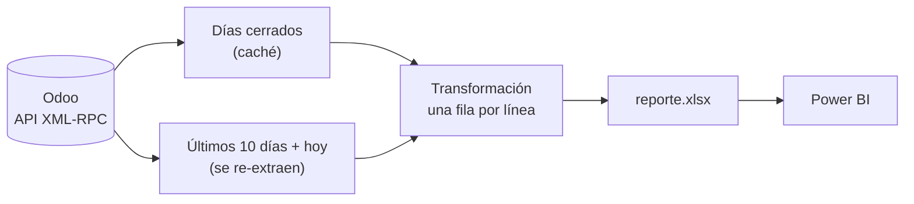

# Actualizar un reporte desde un ERP (Odoo), al minuto

Un script, [`actualizar_reporte.py`](actualizar_reporte.py), que lee las
facturas y notas de crédito de **Odoo** por su API, las deja en una tabla
plana y escribe el Excel que lee Power BI. Puede correr cada minuto: el
reporte ve el día casi en vivo.

**→ [Recorrido por el código, archivo por archivo](docs/recorrido-del-codigo.md)**



## Probarlo en 1 minuto

Python 3.10 o superior. Sin `.env`, corre contra un **Odoo simulado** con datos
inventados: no hace falta una instancia.

```bash
pip install -r requirements.txt
python actualizar_reporte.py              # 1ra vez: baja todo; después, 10 días + hoy
python -m unittest discover -s tests -v
```

```
ACTUALIZAR REPORTE ODOO 17/08/2026 -> 01/10/2026 (incluye hoy)
   [DEMO] sin ODOO_URL en .env: se usa un Odoo simulado con datos inventados
   Odoo: 75 comprobantes publicados en [2026-09-21, 2026-10-01)
   Odoo: 6 comprobantes publicados en [2026-10-01, 2026-10-02)
            comprobantes  lineas importe_neto
dia
2026-09-29            12      24   50,023,800
2026-09-30             6      10   34,773,800
2026-10-01             6      15   52,732,600
   Total: 294 comprobantes, 728 líneas
[OK] reporte.xlsx escrito en 0.2 s
```

Contra un Odoo real: copiar `.env.example` a `.env` con la URL, la base, el
usuario y una API key. Para dejarlo programado cada minuto:
`powershell -ExecutionPolicy Bypass -File programar_tarea.ps1`.

## Decisiones de diseño

- **Caché de días cerrados + ventana de re-extracción.** Bajar todo cada
  minuto sería lento. Los días cerrados se guardan y en cada corrida se
  re-extraen sólo los últimos 10 y el de hoy. La ventana existe porque en Odoo
  una factura cancelada **desaparece** (no deja una fila que la anule) y se
  puede cancelar días después.
- **Conocer cómo guarda Odoo los datos.** El importe sale del `balance`
  contable (con su signo, la nota de crédito queda negativa sola), el precio
  viene con impuesto incluido, el costo está en las líneas de costo de ventas
  del asiento y la cotización de una factura en dólares es la que Odoo usó en
  esa factura.
- **Paginado por id, no por posición.** Con offset/limit, un registro que entra
  durante la lectura corre a todos un lugar y uno se lee dos veces.
- **Reintentos con espera creciente.** Odoo Online devuelve 503 de vez en
  cuando; una tarea que corre cada minuto no puede morir por eso.
- **Un archivo abierto no es un error.** Si el Excel está abierto (alguien lo
  está mirando, o Power BI lo está leyendo), la corrida termina con código 3 y
  `[SKIP]`, y la siguiente escribe. Se chequea antes de llamar a la API y otra
  vez al escribir.
- **Sin ventana, pero con log.** La tarea corre con `pythonw` para no abrir una
  consola por minuto; sin consola, un `print` hace caer el script sin rastro.
  Toda la salida va a `logs/AAAA-MM/reporte_AAAAMMDD.log`.
- **Un Odoo simulado para probar.** Misma interfaz que el cliente real: los
  tests corren sin red y fijan los casos que importan (canceladas, notas de
  crédito, dólares, costo, cancelación tardía).

## Tecnologías

Python (pandas, openpyxl, pyarrow, `xmlrpc.client`) · API XML-RPC de Odoo ·
PowerShell · Programador de tareas de Windows · `unittest`
