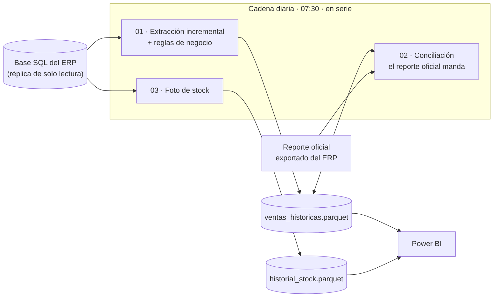

# Pipeline SQL → Parquet → Power BI

Automatización que todos los días extrae las ventas y el stock de la base de
datos de un sistema de gestión (ERP), les aplica las reglas de negocio, las
concilia contra el reporte oficial del sistema y las deja en archivos Parquet
listos para Power BI. Corre sola, con reintentos y un log por día.

> Es la versión genérica de un pipeline que corrió en producción en una
> empresa comercial. El código se reescribió sin ningún dato, regla ni nombre
> de esa empresa, y trae una **base de demostración** (una ferretería
> mayorista inventada) para probarlo sin conectarse a nada.

**→ [Recorrido por el código, archivo por archivo](docs/recorrido-del-codigo.md)**

---

## El problema

- Los informes se armaban **exportando reportes del sistema a mano** todos los
  días: trabajo repetitivo, con horas de atraso y errores de copia.
- El sistema guarda los datos para **operar**, no para **analizar**. Un
  vendedor que factura en dos sucursales, la cartera de un vendedor que se fue,
  un comprobante anulado días después: cada informe lo resolvía a su manera y
  la misma cifra cambiaba según quién la calculara.
- La tabla de stock sólo sabe cuánto hay **hoy**. Sin historia no se pueden
  medir quiebres ni rotación.

## Qué hace

| Paso | Script | Resultado |
|---|---|---|
| 01 | [`01_extraer_ventas.py`](01_extraer_ventas.py) | Trae de la base sólo lo nuevo (más una ventana de días para captar anulaciones), aplica las reglas de negocio y actualiza `ventas_historicas.parquet` |
| 02 | [`02_conciliar_ventas.py`](02_conciliar_ventas.py) | Compara el parquet contra el reporte oficial comprobante por comprobante; lista cada diferencia y, si se pide, corrige |
| 03 | [`03_foto_stock.py`](03_foto_stock.py) | Le saca una foto diaria al stock y la acumula en `historial_stock.parquet` |
| — | [`orquestacion/`](orquestacion/) | Corre los tres pasos en serie todas las mañanas, con reintentos, log y estado |



## Probarlo en 2 minutos

Requiere Python 3.10 o superior.

```bash
pip install -r requirements.txt

python 00_generar_datos_demo.py        # crea la base de demostración (SQLite)
python 01_extraer_ventas.py            # carga inicial: todo 2025 hasta ayer
python 01_extraer_ventas.py            # corrida diaria: sólo re-extrae los últimos 3 días
python 02_conciliar_ventas.py          # encuentra las 5 diferencias sembradas en la demo
python 02_conciliar_ventas.py --corregir
python 03_foto_stock.py

python -m unittest discover -s tests -v   # 15 tests
```

La conciliación de la demo muestra algo así:

```
02 · CONCILIACIÓN 01/09/2026 -> 30/09/2026
estado
OK                 440
DIFERENCIA           3
SOLO EN PARQUET      1
SOLO EN REPORTE      1

Diferencia total: -27,678,411 Gs (0.268% de lo vendido)

Comprobantes con diferencia:
nro_comprobante          estado  monto_neto_parquet  monto_neto_reporte  diferencia
 01-001-0002705      DIFERENCIA           4,219,200           4,008,240    -210,960
 02-001-0002395      DIFERENCIA          10,240,000           9,728,000    -512,000
 04-001-0001727      DIFERENCIA          37,999,020          36,099,069  -1,899,951
 01-001-0002660 SOLO EN PARQUET          26,305,500                 NaN -26,305,500
 04-001-9999999 SOLO EN REPORTE                 NaN           1,250,000   1,250,000
```

Para la cadena completa, tal como la corre el Programador de tareas:

```powershell
powershell -ExecutionPolicy Bypass -File orquestacion\ejecutar_pipeline.ps1
Get-Content logs\pipeline_estado.txt      # [01/10/2026 07:31:02] TERMINADO OK
```

## Decisiones de diseño

Cada una salió de un problema real en producción.

- **El histórico cierra AYER; el día en curso nunca entra.** En Power BI el
  parquet se une con una tabla que trae el día en curso desde el ERP al
  minuto. Si el parquet también tuviera filas de hoy, ese día se contaría dos
  veces. Durante meses no pasó porque la cadena corría temprano, cuando el día
  todavía no tenía ventas: era una casualidad de horario, no una garantía.
  Ahora el tope `< hoy 00:00` está escrito en la consulta.
- **Se re-extrae una ventana, no sólo lo nuevo.** El ERP permite anular o
  corregir un comprobante días después. Cada corrida vuelve a traer los
  últimos N días y los **reemplaza enteros**, así un anulado también
  desaparece del parquet.
- **Rangos largos en bloques, con reintentos.** Una recarga de un año en una
  sola consulta tardaba tanto que un firewall cortaba la conexión a mitad de
  camino. En bloques trimestrales, si uno falla se reintenta sólo ese. Entre
  intentos se descarta la conexión del pool (`engine.dispose()`): si no, el
  reintento reusa la conexión muerta.
- **Nunca se pisa el dato original.** La sucursal real de la factura queda en
  `cod_sucursal` y la que se usa para el reporte va en `cod_sucursal_reporte`.
  En la primera versión se pisaba, y cambiar una regla obligaba a re-extraer
  meses enteros. Ahora una regla nueva se aplica a todo el histórico en la
  próxima corrida.
- **Una sola fuente para cada regla.** Mapeo de vendedores, sucursales
  temporales y excepciones viven en [`config.py`](config.py). Cuando dos
  scripts tenían su propia copia, el mismo vendedor salía en una sucursal en
  ventas y en otra en cobranza.
- **El reporte oficial manda, pero no a ciegas.** La conciliación corrige sola
  sólo si la diferencia total es menor al 2 % de lo vendido. Por encima, algo
  grande está mal (un día sin extraer, un reporte exportado a medias) y
  corregir lo empeoraría.
- **Las correcciones se guardan y se reaplican.** Al corregir, la evidencia de
  la diferencia desaparece; por eso cada corrección queda en una bitácora con
  el monto previo. Y como la extracción re-trae los últimos días con el monto
  viejo de la base, la bitácora se reaplica después de cada extracción.
- **El prorrateo cierra al guaraní.** Repartir un monto de cabecera entre las
  líneas con `neto_línea / SUM(neto)` falla con datos reales: hay comprobantes
  cuyo neto suma cero (división por cero) y líneas de signo mixto. Se usa una
  cascada de bases de reparto y el residuo del redondeo va a la línea mayor.
- **Escritura atómica del parquet.** Se escribe en un temporal propio de cada
  proceso y se reemplaza de una vez; si Power BI tiene el archivo abierto
  (refrescando), se reintenta unos segundos. Un lock impide que dos scripts
  escriban a la vez: una vez pasó, se pisaron el temporal y el parquet quedó
  corrupto.
- **Un día sin foto de stock se pierde para siempre.** Por eso la foto corre
  aunque la extracción de ventas falle, y correrla dos veces el mismo día no
  duplica nada.

## Adaptarlo a una base real

1. Copiar `.env.example` a `.env` y poner la URL de la base (idealmente una
   réplica y un usuario de **solo lectura**).
2. Ajustar en [`config.py`](config.py) los nombres de columna
   (`COLUMNAS_VENTAS`) y las reglas de negocio (sucursales, mapeo de
   vendedores, tipos de operación a excluir).
3. Exportar el reporte oficial del ERP con las columnas `fecha`,
   `nro_comprobante`, `tipo_comprobante`, `monto_neto`.
4. Registrar la tarea: `orquestacion\programar_tarea.ps1`.

La publicación del informe en Power BI cada 10 minutos, sin gateway, está en el
otro proyecto: [pipeline-erp-odoo-a-powerbi/powerbi](../pipeline-erp-odoo-a-powerbi/powerbi/).

## Tecnologías

Python (pandas, SQLAlchemy Core, pyarrow) · SQL (PostgreSQL / SQL Server /
SQLite) · Parquet · PowerShell · Programador de tareas de Windows · Prefect
(opcional) · `unittest`
