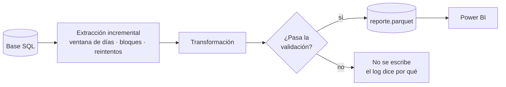

# Actualizar un reporte desde una base SQL

Un script, [`actualizar_reporte.py`](actualizar_reporte.py), que reemplaza el
"exportar del sistema y pegar en Excel": trae de una base SQL sólo lo nuevo,
lo transforma, lo valida y deja el archivo que lee Power BI. Lo dispara el
Programador de tareas de Windows, con reintentos y un log por día.

**→ [Recorrido por el código, archivo por archivo](docs/recorrido-del-codigo.md)**



## Probarlo en 1 minuto

Python 3.10 o superior. Trae una base SQLite de demostración con datos inventados.

```bash
pip install -r requirements.txt
python generar_datos_demo.py           # crea datos/demo.db
python actualizar_reporte.py           # primera vez: carga todo hasta ayer
python actualizar_reporte.py           # después: sólo vuelve a traer los últimos 3 días
python -m unittest discover -s tests -v
```

```
ACTUALIZAR REPORTE: 27/09/2026 -> 30/09/2026
-> Bloque 1/1: 27/09/2026 -> 01/10/2026
   [OK] 85 filas en 0.0 s
            documentos  filas     importe
fecha
2026-09-28          13     31 128,758,800
2026-09-29          10     26  62,814,100
2026-09-30          11     28 125,764,200
[OK] 18,970 filas en reporte.parquet (0.2 s)
```

Contra una base real: copiar `.env.example` a `.env` con la URL de conexión y
ajustar en [`config.py`](config.py) la tabla y sus columnas. Para dejarlo
programado: `orquestacion\programar_tarea.ps1`.

## Decisiones de diseño

- **Incremental, con una ventana que se reemplaza entera.** Cada corrida trae
  sólo los últimos días y los reemplaza completos: un registro anulado o
  corregido en el sistema días después también cambia en el reporte.
- **Rangos largos en bloques, con reintentos.** Una consulta gigante puede
  tardar tanto que un firewall corta la conexión a mitad de camino. En
  bloques, si uno falla se reintenta sólo ese; y entre intentos se descarta la
  conexión muerta del pool.
- **Consulta parametrizada.** El `SELECT` se arma con SQLAlchemy Core: el
  mismo código sirve para PostgreSQL, SQL Server o SQLite, y no hay inyección
  SQL posible.
- **Validar antes de escribir.** Claves repetidas, fechas fuera de rango o
  importes vacíos frenan la corrida y el archivo bueno queda como estaba. Un
  reporte desactualizado se nota; uno con datos malos, muchas veces no.
- **Escritura atómica.** Se escribe en un temporal y se reemplaza de una vez,
  con reintento si Power BI tiene el archivo abierto, y con un lock para que
  dos corridas nunca escriban a la vez.
- **El día en curso, opcional.** Si a Power BI el día le llega por otro camino,
  el reporte cierra en ayer para no contarlo dos veces.
- **Credenciales fuera del código**, en un `.env` que no se sube.

## Tecnologías

Python (pandas, SQLAlchemy Core, pyarrow) · SQL · Parquet · PowerShell ·
Programador de tareas de Windows · `unittest`
