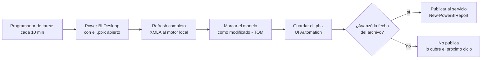

# Power BI Pro: refrescar y publicar cada 10 minutos, sin gateway

[`actualizar_y_publicar.ps1`](actualizar_y_publicar.ps1) mantiene un informe de
Power BI actualizado en el servicio **cada 10 minutos** con una licencia
**Pro** y **sin gateway**, cuando los datos salen de archivos locales (parquet,
Excel, CSV). Un ciclo típico tarda unos 2 minutos: refresh de 0,5 a 1 min,
guardado de unos 15 s y publicación de unos 30 s.

## El problema

- Con Pro, el servicio permite como máximo **8 actualizaciones programadas por día**.
- Si los orígenes son archivos de la PC, el servicio no llega a ellos sin un **gateway**.
- El informe tiene que estar casi al día durante toda la jornada.

## La idea

Power BI Desktop trae adentro un motor de Analysis Services. En vez de pedirle
al servicio que refresque, el refresh se hace **en Desktop**, se guarda el
`.pbix` y se **vuelve a publicar**. Publicar no es una actualización
programada (no cuenta contra el tope de 8) y los datos viajan dentro del
archivo (el servicio nunca necesita llegar a la PC).



## Paso a paso

**1. Encontrar Desktop y su motor.** Busca el proceso `PBIDesktop` con el
informe abierto en dos capas: por el título de la ventana y, si un diálogo lo
tapa, por la línea de comando del proceso. Nunca abre una segunda instancia.
El motor es `msmdsrv.exe`, **proceso hijo** de Desktop; su puerto cambia cada
vez que se abre, así que se busca en cada ciclo:

```powershell
$motor  = Get-CimInstance Win32_Process -Filter "Name='msmdsrv.exe'" |
          Where-Object { $_.ParentProcessId -eq $pidDesktop }
$puerto = (Get-NetTCPConnection -OwningProcess $motor.ProcessId -State Listen).LocalPort
```

**2. Refresh completo por XMLA**, con un comando TMSL y siempre con tope de tiempo:

```powershell
$tmsl = '{"refresh":{"type":"full","objects":[{"database":"' + $catalogo + '"}]}}'
Invoke-ASCmd -Server "localhost:$puerto" -Query $tmsl -QueryTimeout 420
```

**3. Marcar el modelo como modificado.** Es el paso menos obvio: un refresh de
datos por XMLA **no** le avisa a Desktop que hay cambios, así que "Guardar" no
hace nada y el archivo se queda con los datos viejos, sin ningún error. Un
cambio de **metadatos** por TOM sí lo detecta: se escribe una *annotation* con
la hora del ciclo.

**4. Guardar sin robar el foco.** El botón Guardar tiene
`AutomationId = 'save'` (su nombre cambia con el idioma, el id no) y el patrón
`Invoke` de UI Automation **no necesita que la ventana esté al frente**: se
puede seguir usando la PC. La ventana se busca con `EnumWindows` (la de clase
`WindowsForms10.Window*`), porque `MainWindowHandle` puede apuntar a la
ventana oculta del navegador embebido. Después **verifica** que la fecha del
archivo avanzó: **si no, no publica**.

**5. Publicar** con `New-PowerBIReport -ConflictAction CreateOrOverwrite`, que
reemplaza informe y modelo **conservando el mismo id**: los enlaces y los
paneles no se rompen.

## Lo que se rompió en producción y cómo se defiende el script

| Síntoma | Causa | Qué hace el script |
|---|---|---|
| El `.pbix` no se actualiza, sin ningún error | El refresh por XMLA no marca cambios sin guardar | Annotation por TOM antes de guardar |
| Ciclos que no publican mientras alguien usa la PC | Windows no le da el foco a un proceso en segundo plano | Guardado por UI Automation, sin foco |
| Un refresh colgado y **todos** los ciclos siguientes caídos | Matar al cliente no cancela el comando en el motor; el `<Cancel>` responde OK y se ignora | Tope de 7 min; si quedan jobs vivos **propios**, cierra Desktop y el ciclo siguiente lo reabre limpio |
| Desktop trabado por un diálogo | Nadie cierra el diálogo | Tras 2 guardados fallidos seguidos, cierra Desktop |
| Dos ventanas del mismo informe | El título no coincidía justo en ese momento | Detección en dos capas y 2 min de espera antes de abrir |

Sobre el refresh colgado: el script mira `$SYSTEM.DISCOVER_JOBS`. Al entrar,
un job `Process` de 12 minutos o más es uno colgado de antes. Si su propio
refresh vence el tope, cierra Desktop **sólo** si los jobs que quedaron llevan
el mismo tiempo que su refresh: si llevan otro, son de alguien que está
refrescando a mano, y cerrar Desktop le borraría lo que no guardó.

## Instalación

```powershell
Install-Module SqlServer -Scope CurrentUser               # Invoke-ASCmd y TOM
Install-Module MicrosoftPowerBIMgmt -Scope CurrentUser    # publicar

# 1. una sola vez: guarda la cuenta cifrada con DPAPI (sólo este usuario en esta PC)
powershell -ExecutionPolicy Bypass -File guardar_credencial.ps1 -Workspace "Ventas"

# 2. probar sin publicar, después completo
powershell -ExecutionPolicy Bypass -File actualizar_y_publicar.ps1 -Pbix "C:\ruta\Informe.pbix" -SoloRefrescar
powershell -ExecutionPolicy Bypass -File actualizar_y_publicar.ps1 -Pbix "C:\ruta\Informe.pbix" -Workspace "Ventas"
```

La tarea cada 10 minutos la registra [`programar_publicacion.ps1`](programar_publicacion.ps1):

```powershell
powershell -ExecutionPolicy Bypass -File programar_publicacion.ps1 -Pbix "C:\ruta\Informe.pbix" -Workspace "Ventas"
```

Un ciclo normal en el log:

```
15:00:03 === inicio ciclo (SoloRefrescar=False) ===
15:00:07 Desktop PID 10440, motor en localhost:62235, modelo 00000000-0000-0000-0000-000000000000
15:01:05 Refresh OK en 1,0 min
15:01:26 Guardado OK (15:01:24)
15:02:05 Publicado OK en 0,6 min (informe 00000000-0000-0000-0000-000000000000)
```

## Limitaciones

- **La fuente de verdad es el `.pbix` local**: lo que se edite directo en el
  servicio se pierde en la publicación siguiente.
- **El guardado guarda todo lo que haya en la ventana.** Para editar el informe
  con calma, pausar la tarea (`Disable-ScheduledTask`).
- **El refresh por XMLA sólo recarga las columnas que el modelo ya conoce.** Si
  el origen trae una columna nueva, hay que refrescar una vez a mano en Desktop.
- **El `.pbix` viaja entero en cada ciclo**: cuenta el límite de 1 GB de Pro.
- **MFA:** una contraseña guardada no sirve para un login desatendido si la
  cuenta exige MFA; la alternativa es un *service principal*.
- Necesita la PC encendida y con la **sesión abierta**: Desktop es una
  aplicación con interfaz.
